  

WHAT I WORK WITH

  
  
  
  
   
  
  
  
  

JUMP TO

  
  
  

GET IN TOUCH

  
  

## 👨‍💻 About me

- 🎓 4th-year student at the Faculty of Computers & Artificial Intelligence, Benha University
- 📱 I build mobile apps with **Flutter & Dart** - clean architecture, BLoC state management, and Firebase backends
- ☁️ Currently exploring: **AWS Cloud**, **Python/Flask**, and embedded systems with **Arduino**
- 🎯 Goal: keep growing as a mobile engineer and ship apps people actually rely on

## 🚀 Featured projects

  
  

| Project | What it does | Built with |
| --- | --- | --- |
| [**Movie**](https://github.com/Ahmed-Mhmd/Movie) | Movie browser powered by the TMDB API - popular, upcoming and top-rated lists, search, details, and a local watch list | Flutter, BLoC, get_it + injectable (DI), Hive, REST APIs |
| [**Tasky**](https://github.com/Ahmed-Mhmd/Tasky-APP) | Task manager with priorities and a calendar view | Flutter, Firebase Auth, Cloud Firestore, table_calendar |

## 🧰 Tech stack

   
  

  
  
  
  

## 📊 GitHub in numbers

  
  

  

  

